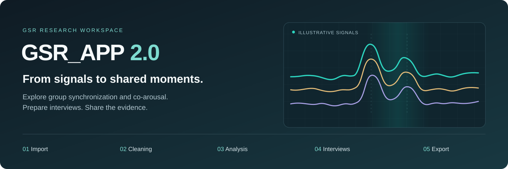
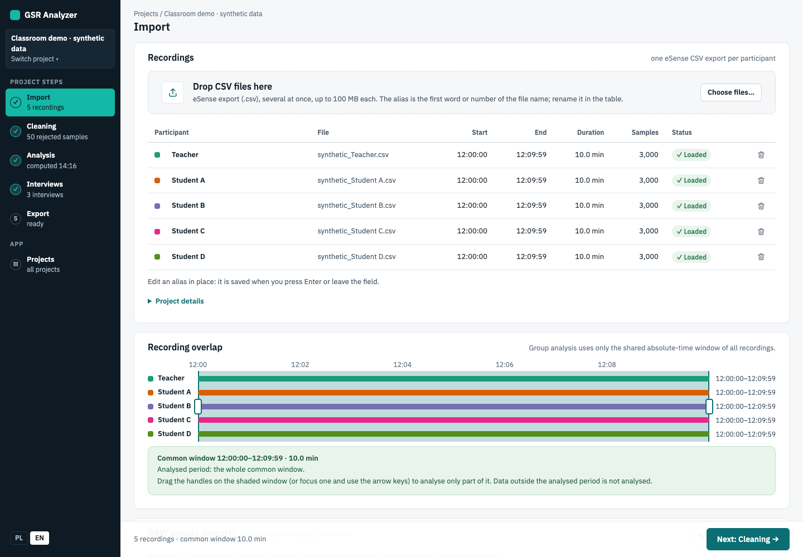
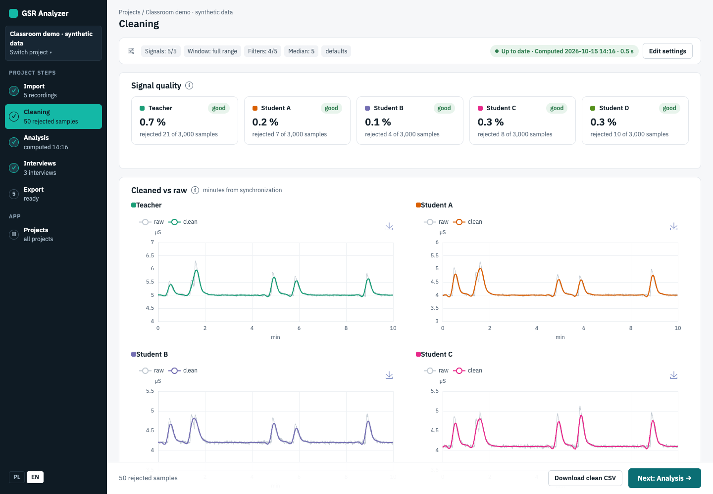
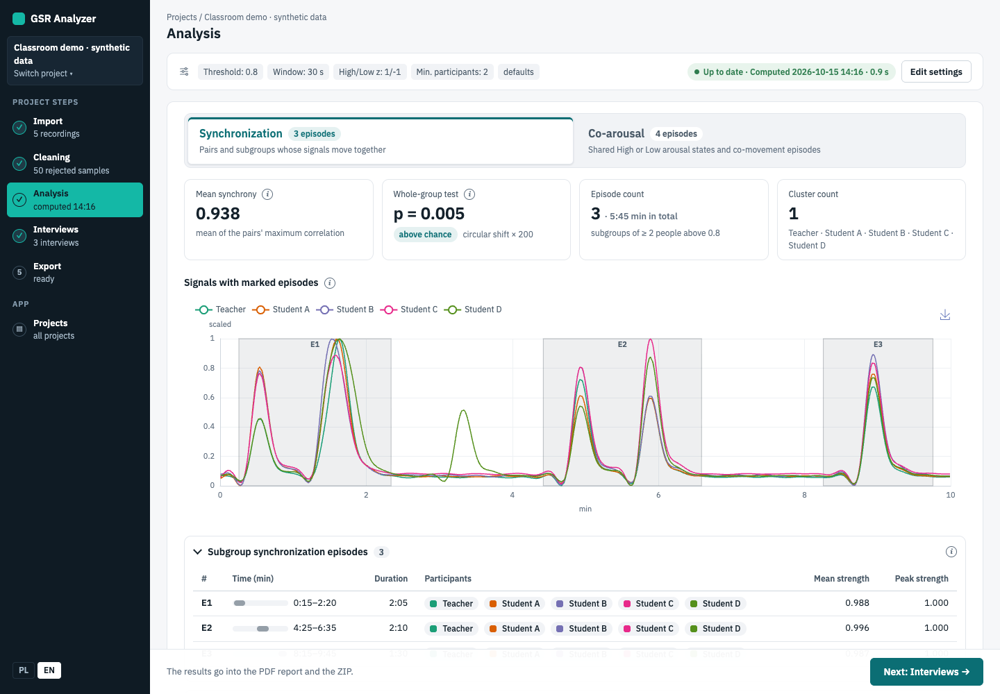
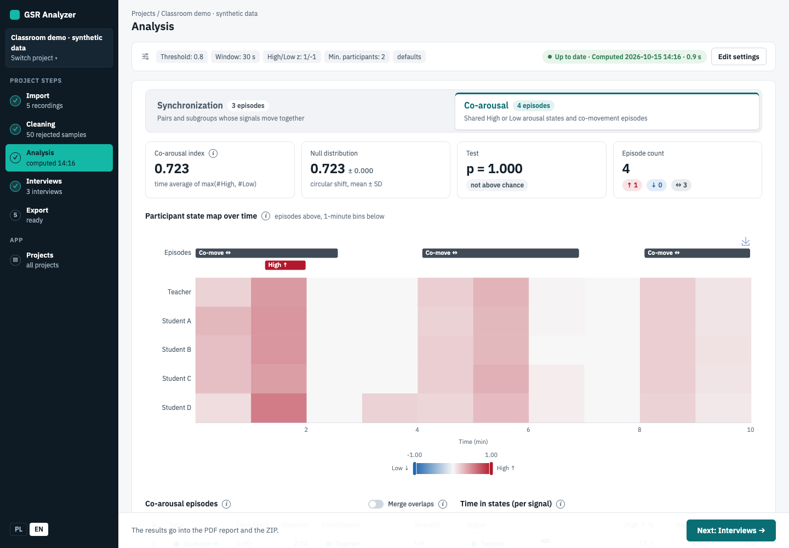
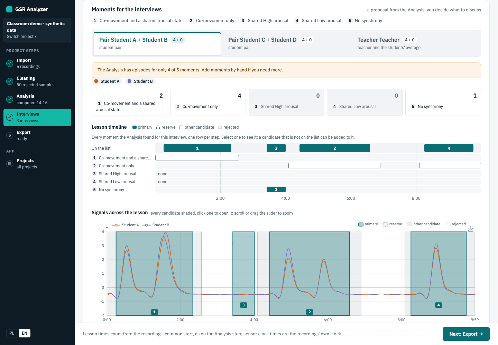
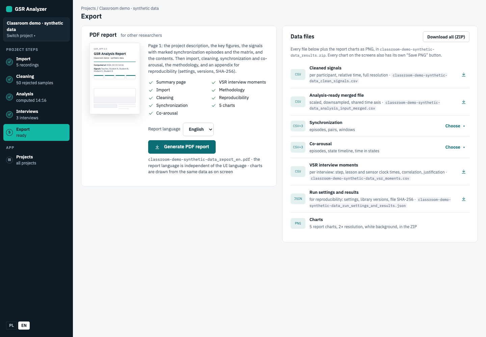

# GSR_APP 2.0

**A local research workspace for GSR data, group synchronization, co-arousal, and VSR interviews.**

[Quick start](#quick-start) · [App tour](#what-it-does) · [Workflow notes](#workflow-notes) · [Research methodology](docs/research-gsrv2.md)

## What it does

Turn eSense skin-conductance recordings into an explorable group session. Import recordings,
inspect and clean the signals, analyze how participants' signals move together, then curate
moments for video-stimulated recall (VSR) interviews and export a research report.

The tour below shows the real app with **synthetic demo data only**. Click any screenshot to
see it at full size.

| **1 · Import** | **2 · Cleaning** |
| --- | --- |
| [](docs/assets/import.png) | [](docs/assets/cleaning.png) |
| Upload CSV recordings, assign aliases, and inspect the common recording period. | Review signal quality, exclude recordings, and preview synchronized, cleaned signals. |
| **3 · Analysis / Synchronization** | **3 · Analysis / Co-arousal** |
| [](docs/assets/synchronization.png) | [](docs/assets/coarousal.png) |
| Explore pairs and subgroups whose signals move together. | Inspect shared high/low arousal states and co-movement in a second tab of the same run. |
| **4 · Interviews** | **5 · Export / PDF** |
| [](docs/assets/interviews.png) | [](docs/assets/export.png) |
| Choose teacher and student-pair interviews; review, accept, reject, or adjust suggested moments. | Share a PDF report in English or Polish, or download tables, settings, results, and charts. |

### Key features

- **One connected workflow:** Import → Cleaning → Analysis → Interviews → Export, with saved results and outdated-result warnings.
- **Two complementary analyses:** group synchronization and co-arousal, with interactive charts and episode tables.
- **Researcher-led interviews:** candidate timelines, signal previews, evidence-based justifications, and preserved curation decisions.
- **Portable outputs:** bilingual PDF, CSV, JSON, chart PNGs, or a complete ZIP bundle.
- **Local-first setup:** one Docker container, persistent storage, and an English/Polish interface.

The app currently has no login for the research workspace. Use it locally for one person;
add Django authentication before hosting it for multiple users. The admin has a separate login.

## Quick start

1. Install [Docker Desktop](https://www.docker.com/products/docker-desktop/) (or Docker
   Engine with the Compose plugin) and start it.
2. Get the code: `git clone https://github.com/WWiertelak/gsr-app-2.git && cd gsr-app-2`
3. Start the app: `docker compose up -d --build` (the first build takes a few minutes).
   No configuration file is needed.
4. Open <http://localhost:8017/> in your browser.

To stop it, run `docker compose down`. Your projects and uploaded files are kept.

### Log in to the admin

The admin panel is at <http://localhost:8017/admin/>. Create an admin account once:

```bash
docker compose exec app python manage.py createsuperuser
```

Enter a username, an optional email and a password when asked, then log in at
<http://localhost:8017/admin/> with that username and password.

## Workflow notes

The processing pipeline is extracted from GSRv2 with unchanged results under matching settings; the
segment-based analysis was dropped. See [docs/research-gsrv2.md](docs/research-gsrv2.md)
for how the pipeline works and what was carried over.

The UI is server-rendered Django templates with HTMX and ECharts (no Node build), in
Polish or English (switch in the left rail). The workflow is
Projects → 1 Import → 2 Cleaning → 3 Analysis (Synchronization | Co-arousal tabs, one run)
→ 4 Interviews (VSR interview moments per student pair and for the teacher: the Analysis rules and
settings applied to each interview's own two signals - the pair's two, or the teacher and the students'
average, as the flow chart asks - so a pair's moments do not depend on who else is in the project; the
episodes are sorted by the steps of the "VSR Interview Flow Chart", each with a preview of the
signals and a one-sentence justification; a lesson timeline shows every
candidate moment, one row per step, and the interview's signals across the whole
lesson with every candidate shaded on the chart itself (primary moments filled and numbered,
reserve moments dashed and numbered, other candidates light grey, rejected ones dotted, a key on
the chart, a click on a band opens it); the researcher accepts, rejects, reorders, retimes or adds
moments, also straight from the timeline, and choosing again keeps those decisions) → 5 Export (bilingual PDF report
for other researchers, with the interview moments and their justifications as its own
section; CSV tables including `vsr_moments.csv`, a run settings + results JSON, chart PNGs, or
all of it as a ZIP). Re-running or changing an earlier step marks later saved results
outdated until each is refreshed in order. The flow chart's correlation criteria ("Synchronous = above
0.8", "Asynchronous = below 0.1") are read as the strength of the correlation, its absolute value, and
Hassan's team's e-mail adds the types the chart leaves out. The steps are 1 co-movement and a shared state,
2 co-movement only (both with a moment r of at least 0.8), 3 shared High, 4 shared Low (whole episodes, as
in Hassan's script), 5 no synchrony
(opposite arousal, one person High while the other is Low, then a decoupling stretch, every 30 s window
|r| < 0.1 for at least the minimum episode duration as in Hassan's script, closest to zero first; the
decoupling rule is an Analysis setting) and then 4b divergent synchrony (signals moving in opposite directions,
moment r at most -0.8), walked after step 5 so the five primary moments keep the chart's "4 synchronous,
1 not synchronous"; their order lives in one tuple (`pipeline/vsr.py` `PROTOCOL`). The Analysis finds
divergent synchronization episodes (r <= -0.3 in every window), decoupling stretches and opposite-arousal
episodes (z above +1 while another is below -1) as its own types. New projects start with the values
the VSR Interview Flow Chart and the e-mail suggest and, where the chart is silent, the values of Hassan's
script (`VSR_DOCUMENT_SETTINGS`: 0.8 for the interview moments; from the script, Spearman correlation,
co-movement detected from 0.3, as divergent synchrony is detected from -0.3, and a dyad - a two-person
project or an interview's own two signals - joins no episodes across gaps, since joining exists to keep a
subgroup's episode together when its membership changes and two people have no subgroups (his script is such a
dyad analysis); a class keeps GSRv2's 15 s / 30 s joining; 0.1 decoupling, High/Low at
z = +/-1, shared High/Low episodes whole even with co-movement during them; 5 moments per interview plus 3 in
reserve); projects saved earlier keep GSRv2's synchronization and co-movement settings until "Reset
defaults" in the Analysis settings sets these. The 5 + 3 moment counts are the existing defaults;
the reset does not change them, they are edited on the Interviews step. Interview pairs can be added and removed
with the form buttons; removed pairs retain curated decisions for restoration when
the same pair is added again. Every table, chart axis, CSV/JSON export and the PDF report give the
GSR recordings' own clock (the sensor clock, which the researcher uses to locate a moment in the
lesson's other data) next to the lesson time; lesson time is written m:ss and counts from the
recordings' common start. Every result is computed on z-scores within the analysed period (or on
correlations, which no rescaling changes); the "Signals with marked episodes" chart, the PDF and
`analysis_input_merged.csv` show the signals as z-scores (default, with the High/Low thresholds) or as
0-1 min-max, switched next to the chart without rerunning anything.

### Physiological cleaning range

The physiological filter defaults to **0.5–100 µS**, so sustained skin conductance above
20 µS is retained by that filter. The z-score and jump filters still apply independently.
The Cleaning settings show the current bounds, and the report records the bounds used.

No saved project settings are migrated: an explicit saved upper limit (including 20 µS)
is preserved. Projects without an explicit upper limit use the new 100 µS default when
resolved; their earlier saved results become outdated and need recomputing. Until rerun,
their exports and applied-settings views show the new 100 µS limit, not the 20 µS that was used.

## Layout

- `backend/gsr/pipeline/` - Django-free pipeline: `parser` (eSense CSV), `preprocessing`
  (synchronization, cleaning, scaling, merge, downsampling), `synchrony` (joint
  synchronization), `coarousal` (co-arousal), `vsr` (VSR interview moment selection),
  `config` (`PipelineConfig`).
- `backend/gsr/models.py`, `backend/gsr/services/` - projects, dataset upload, analysis service,
  stored last results per screen (`results`), exports (`exports`), interview roles and the
  number of moments kept outside the analysis signature (`interview`), the Interviews step's
  moments chosen from the stored analysis run (`vsr`), the researcher's decisions on each
  interview's list of moments (`curation`, model `InterviewMoment`).
- `backend/gsr/views.py`, `backend/gsr/templates/gsr/`, `backend/gsr/static/gsr/` - UI screens
  (`vsr_text.py` writes each moment's justification sentence in the UI language);
  `static/gsr/js/charts.js` holds the ECharts option builders ported from GSRv2,
  `static/gsr/vendor/` the pinned htmx and ECharts builds and the IBM Plex web fonts (`fonts/`, SIL OFL).
- `backend/gsr/reporting/` - PDF report (HTML template converted to PDF by WeasyPrint; shares the app's `static/gsr/css/tokens.css` and IBM Plex fonts, with bundled DejaVu fonts as the glyph fallback) and its methodology text; `interviews` lays out the VSR interview moments section and `vsr_charts`
  draws its SVG charts on the server.
- `backend/gsr/locale/pl/` - Polish UI strings. After changing UI text run
  `python manage.py makemessages -l pl --no-obsolete --ignore=.venv --ignore=staticfiles`, translate,
  then `python manage.py compilemessages --ignore=.venv` (needs gettext) and commit both files.
- `backend/gsr/tests/` - unit tests and old-vs-new equivalence tests (synthetic data only).

## Run with Docker

The app runs as one container: on start it applies migrations, then serves Django with
gunicorn on container port 8000, published on host port 8017. The image compiles the
`dtaidistance` C/OpenMP extensions at build time (see `backend/Dockerfile`); without them,
class-sized synchrony analyses fall back to pure-Python DTW and exceed the HTTP worker
timeout. Startup runs only the `gsr_dtw_c`-tagged Django check `gsr.E001`
(`manage.py check --tag gsr_dtw_c --fail-level ERROR`), which fails when that library is missing
and `GSR_REQUIRE_DTW_C=1` (set in the image).
The SQLite database
(`/data/db.sqlite3`), uploaded files (`/data/storage`) and the generated secret key
(`/data/secret_key`) live on the `gsr_data` volume, so they survive restarts and rebuilds.

```bash
docker compose up -d --build    # UI at http://localhost:8017/ (admin at /admin/)
docker compose logs -f app

# Create an admin user / run the CLI analysis inside the container:
docker compose exec app python manage.py createsuperuser
docker compose cp a.csv app:/data/a.csv && docker compose cp b.csv app:/data/b.csv
docker compose exec app python manage.py gsr_analyze A=/data/a.csv B=/data/b.csv \
    --config '{"scaling_enabled": true}' --output /data/result.json

# Run the test suite in the test image (adds dev dependencies):
docker compose --profile test run --rm test

docker compose down             # keeps data; add -v to delete the gsr_data volume
```

Without compose: `docker build -t gsr-app-2 backend` and
`docker run --env-file .env.example -p 127.0.0.1:8017:8000 -v gsr_data:/data gsr-app-2`.

### Environment variables

None are required. `docker-compose.yml` loads safe local defaults (plain HTTP on
localhost) from `.env.example`. To change them, copy `.env.example` to `.env` and edit it;
values in `.env` override the defaults. Hosting the app beyond localhost needs at
least `ALLOWED_HOSTS` and, behind TLS, the `SECURE_*` settings.

| Variable | Default | Purpose |
| --- | --- | --- |
| `SECRET_KEY` | generated once into `secret_key` next to the SQLite file (`/data/secret_key` in the image) when `DEBUG=0` | Django secret key; set it only to use your own |
| `DEBUG` | `1` in settings, `0` in compose | Django debug mode |
| `ALLOWED_HOSTS` | `localhost` (`*` when `DEBUG=1`); `localhost,127.0.0.1` in compose | Comma-separated host names; keep `localhost` for the container healthcheck |
| `SECURE_SSL_REDIRECT` | `1` when `DEBUG=0`; `0` in compose | Redirect HTTP to HTTPS; set `1` behind a TLS proxy |
| `SECURE_COOKIES` | `1` when `DEBUG=0`; `0` in compose | Secure flag on session/CSRF cookies; set `1` with TLS |
| `SECURE_HSTS_SECONDS` | `31536000` when `DEBUG=0`; `0` in compose | HSTS max-age; keep `0` without TLS |
| `MAX_UPLOAD_MB` | `100` | Upload size limit |
| `MAX_DATASETS` | `20` | Datasets per analysis |
| `SQLITE_PATH` | `/data/db.sqlite3` in the image | SQLite database file |
| `STORAGE_ROOT` | `/data/storage` in the image | Uploaded file storage |
| `APP_PORT` | `8017` | Host port (compose only, bound to 127.0.0.1) |
| `GUNICORN_WORKERS` | `2` | gunicorn worker count |
| `GUNICORN_TIMEOUT` | `300` | gunicorn worker timeout in seconds (class-sized analysis ~8s with compiled DTW; omitting `--timeout` defaults to 30s) |
| `GSR_REQUIRE_DTW_C` | `1` in the image | When enabled, the `gsr_dtw_c`-tagged check `gsr.E001` (run by `manage.py check` and at startup) fails if the compiled dtaidistance library is missing |

## Run locally

```bash
cd backend
python3.12 -m venv .venv && . .venv/bin/activate
pip install -r requirements-dev.txt
python manage.py migrate
python manage.py runserver      # UI at http://127.0.0.1:8000/
pytest -q
ruff check config gsr

# Analyze recordings without a UI:
python manage.py gsr_analyze A=path/a.csv B=path/b.csv --config '{"scaling_enabled": true}' --output result.json
```
